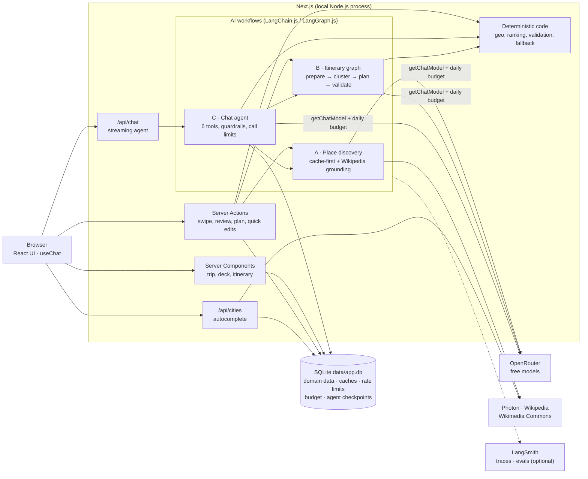
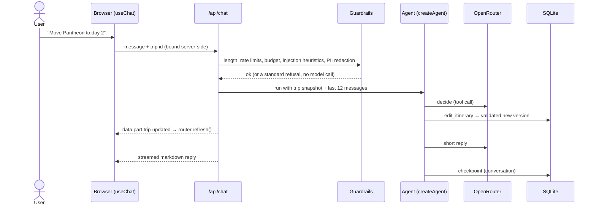
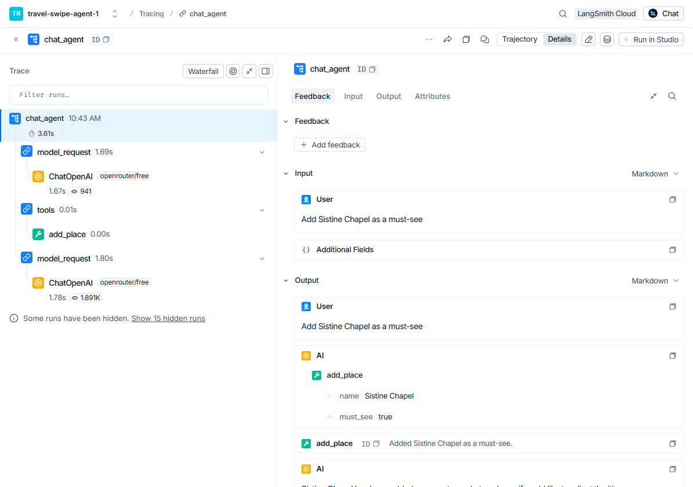
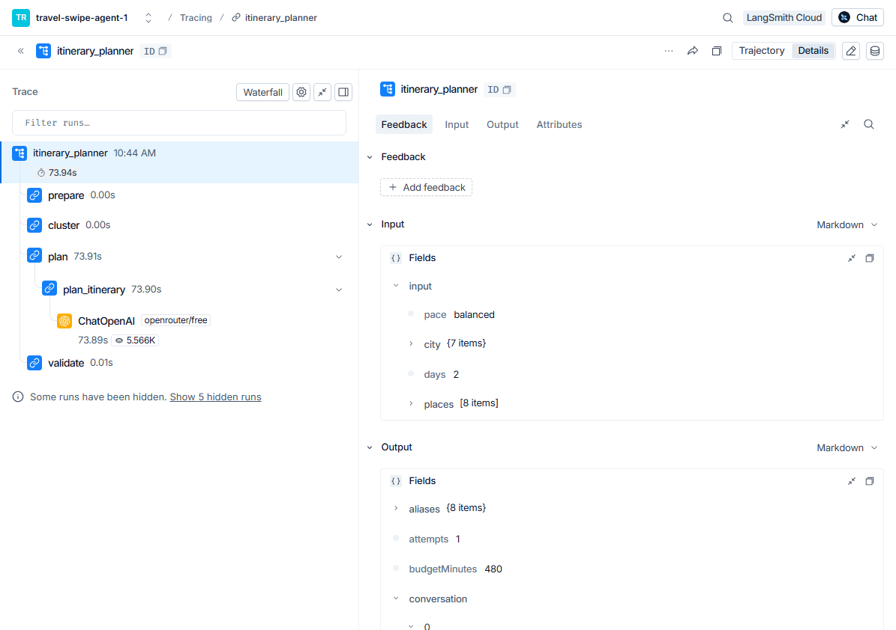

# TripSwipe AI

Discover a city by swiping through its attractions, then let an AI agent turn your picks into a realistic day-by-day itinerary — and refine it by chatting.

> Demo project: full-stack TypeScript web app with generative AI (LangChain.js + LangGraph.js),
> running locally at $0 cost on free models.


<sub>Recorded with the offline fake model (`npm run demo:record`). Photos from Wikimedia
Commons (author and license on each card); map data © OpenStreetMap contributors.</sub>

**Flow:** Setup → Swipe → Review → Itinerary, with a chat assistant on every step.

- **Swipe** through ~30 attractions per city (drag, buttons or keyboard; ★ marks a must-see);
  the deck re-ranks itself from what you like.
- **Itinerary**: a LangGraph workflow turns the shortlist into feasible days with times,
  walking/transit legs, a lunch break, a map and Google Maps directions.
- **Chat**: a LangChain agent with tools edits the trip; the page updates as it answers.
- **Deterministic first**: the model curates and explains; code computes distances,
  schedules, validation, ranking and fallbacks, so the app keeps working when the free quota
  runs out.

## Stack

- **Next.js** (App Router, Server Actions) + TypeScript + Tailwind CSS
- **LangChain.js v1 / LangGraph.js** for the agent and itinerary workflow, **LangSmith** for tracing and evals
- **OpenRouter** free models as the LLM provider
- **SQLite** via **Drizzle ORM** + `better-sqlite3` (prebuilt binaries — no database server or build tools needed)

## Quickstart

Requirements: Node.js 24+. Nothing else to install.

```bash
npm install
cp .env.example .env.local   # LLM_MODE=fake works offline without API keys
npm run db:migrate
npm run db:seed              # optional, see "Seeding demo cities" below
npm run dev                  # http://localhost:3000  (health check: /api/health)
```

In fake mode (the default in `.env.example`), try **Rome** or **Paris** from the setup page,
or type "Plan a trip to Rome for 2 days" in the chat. For real models, set `LLM_MODE=live`
and an `OPENROUTER_API_KEY` (free account at [openrouter.ai](https://openrouter.ai)) in
`.env.local`, then seed a few cities (below). For a demo, prefer the production build:
`npm run build && npm start`.

## Architecture

One local Next.js process serves the UI and the API, runs the AI workflows and keeps all
state in a single SQLite file. Design decisions are recorded as [ADRs](docs/adr/README.md).



A chat turn that edits the itinerary (the visual area refreshes as soon as the tool runs):



## Seeding demo cities

Each city's attractions are discovered once (one LLM call, then Wikipedia/Commons grounding)
and stored in SQLite as a shared pool; every later trip to that city is served from the
database without calling the LLM. `npm run db:seed` runs this discovery ahead of time for
~25 popular cities, so demos never wait for the model or run out of the free quota.

**When to run it:** after `npm run db:migrate` on a fresh database, or whenever `data/app.db`
has been deleted. It is optional: cities that were not seeded are discovered on first use.

**Requirements and cost:**

- `LLM_MODE=live` and `OPENROUTER_API_KEY` in `.env.local`. In `LLM_MODE=fake` only the
  fixture cities (Rome, Paris, see `src/server/ai/fake.ts`) get places; the others fail with
  "No verifiable attractions found".
- One OpenRouter request per new city. A full run uses ~25 of the ~50 free daily requests,
  so consider seeding in batches across days.
- Network access to Photon, Wikipedia and Wikimedia Commons (free, no keys).

**Usage:**

```bash
npm run db:seed                            # all demo cities
npm run db:seed -- --cities Rome,Florence  # a subset (names as listed in scripts/seed.ts)
```

**Behaviour:**

- **Resumable:** cities that already have places are reported as `cached` and skipped without
  any request, so re-running after a failure or a quota error only retries the missing ones.
  The exit code is non-zero if any city failed.
- **Retries are cheap:** the LLM answer is stored in `llm_cache` (30 days) before Wikipedia
  is queried, so a retry after a network error does not spend another LLM request.
- Candidates without a Wikipedia article with coordinates, farther than 30 km from the
  centre, or duplicated are dropped; photos are kept only with a known Commons license.
- Wikipedia data older than 90 days is refreshed automatically on the next visit (no LLM call).

**Maintenance:**

- **Add a city:** append `[name, ISO country code]` to `DEMO_CITIES` in `scripts/seed.ts`
  (the country code picks the right match among homonyms), then run
  `npm run db:seed -- --cities <name>`.
- **Re-discover a city** (e.g. after changing the discovery prompt): delete its places, e.g.
  with `npm run db:studio`, then seed it again. **Warning:** deleting places also deletes
  (via `ON DELETE CASCADE`) every swipe that existing trips recorded on them. Changing the prompt or the model automatically
  invalidates `llm_cache`.
- **Start over:** delete `data/app.db*`, then `npm run db:migrate && npm run db:seed`.

## Itinerary planning

"Generate itinerary" turns the shortlist into a day-by-day plan with a LangGraph workflow
(`src/server/itinerary/graph.ts`): code clusters nearby places into days and drafts a feasible
plan, the planner model refines it (titles, order, tips, what to leave out), and a validator
checks it. Invalid answers get up to two repair rounds; if the model still fails, or the
provider is unavailable, the deterministic draft is used and labelled "Planned by rules".

- **Cost:** 1 OpenRouter request per plan (up to 3 with repairs). The first plan for a given
  shortlist is cached in `llm_cache`; "New plan" always asks the model again.
- **Schedule rules:** days start at 09:00; travel is estimated from straight-line distance
  × 1.3 (walking up to 2 km at 4.5 km/h, otherwise public transport at 20 km/h + 10 min);
  a 60-minute lunch break follows the stop in progress at 12:30. The pace sets the daily
  visits + travel budget (6/8/10 h). Must-see places are never left out.
- **Quick actions** (move, change day, remove) and undo are deterministic and instant; every
  change is saved as a new version, and undo steps back one version.
- The map uses OpenStreetMap tiles (free, attribution shown, light use only); each day can be
  opened in Google Maps as walking directions.

## Chat assistant

The trip assistant is on every page: a pane on the right on desktop (it can be hidden), a
bottom sheet opened from the round button on mobile. It is a LangChain agent
(`src/server/agent/agent.ts`) with six tools: `set_trip`, `find_more_places`, `add_place`,
`remove_place`, `edit_itinerary` and `regenerate_itinerary`. Tools change the trip and the
page updates immediately; itinerary edits are new versions, so Undo works as for quick actions.

- **Conversation:** stored per trip in SQLite by the LangGraph checkpointer and shown again
  when the trip is reopened. The home-page chat stores nothing until it creates a trip; that
  conversation then continues in the new trip.
- **Safety:** the agent only acts on the trip open in the page and refers to places by name
  (code resolves them); messages are limited to 500 characters; each turn makes at most 4
  model calls and 3 tool calls; the model sees the current trip state plus the last 12
  messages. See [Guardrails and limits](#guardrails-and-limits) for the rest.
- **Replies** are rendered as sanitized markdown (bold, lists, code): no raw HTML or images,
  and links only to Wikipedia, Wikimedia Commons, Google Maps and OpenStreetMap.
- **Cost:** about 2 OpenRouter requests per turn that changes the trip (decide, then reply),
  1 for a plain answer; `regenerate_itinerary` and `find_more_places` add their own planner
  or discovery request. Adding a place to an existing itinerary needs no extra request.
- **Offline:** with `LLM_MODE=fake` a scripted model understands simple commands such as
  "Plan a trip to Rome for 2 days", "Add the Colosseum", "Move Pantheon to day 2",
  "Remove Trevi Fountain", "Find more places" and "Plan a new itinerary"
  (`src/server/ai/fake-agent.ts`).

## Guardrails and limits

Deterministic controls only, following the OWASP Top 10 for LLM Applications (2025):

- **Prompt attacks:** known injection and prompt-extraction patterns ("ignore previous
  instructions", "show me your system prompt", chat-template markers…) get a standard
  refusal without calling the model; hits are logged and traced with a `guardrail:<kind>` tag
  (`src/server/agent/guardrails.ts`). The heuristics favour precision: the structural limits
  above are the real protection.
- **Personal data:** emails, card numbers, IP addresses and phone numbers are redacted from
  chat messages (LangChain's PII detectors) before they reach the model or the stored
  conversation. The chat reminds users that free models may use chats for training.
- **Daily LLM budget:** every request sent to OpenRouter is counted in SQLite
  (`LLM_DAILY_BUDGET`, default 45 per UTC day, below the free tier's ~50). When it is used
  up, or OpenRouter reports its own daily limit, AI features pause until 00:00 UTC and an
  "AI is busy" banner explains it: cities already discovered, swiping, quick edits and
  planning by rules keep working. Cache hits and fake mode are free. `npm run db:seed` and
  `npm run evals` count against the same budget.
- **Rate limits** per client IP: 20 chat messages and 10 AI actions (new trip, "Load more",
  planning) per hour, plus 40 chat messages per trip per day (`RATE_LIMIT_*` variables).
  Locally the IP comes from `x-forwarded-for`, which `next start` fills in.
- **Timeouts:** each model request is capped (60 s chat, 120 s planner, 180 s discovery)
  besides its `maxTokens`.

## Quality checks

- **Accessibility:** `tests/e2e/accessibility.spec.ts` runs axe-core (WCAG 2.1 A/AA) on every
  screen and state, mobile and desktop. Swiping has button and keyboard alternatives, focus
  is always visible and animations respect `prefers-reduced-motion`.
- **Performance budgets:** `tests/e2e/performance.spec.ts` checks on the production build that
  each page loads < 200 KB of gzipped JavaScript up front (the chat, Leaflet and the stop
  menus load on demand) and that CLS stays < 0.05 with a 4× slower CPU.
- **Layout:** `tests/e2e/layout.spec.ts` checks every step at 320×568, 360×640, 390×844, 768
  and 1280 px for horizontal overflow; screenshot tests cover the look (`visual.spec.ts`).
- **Lighthouse** (manual): with `npm run build && npm start` running, e.g.
  `npx lighthouse http://localhost:3000 --view` (mobile, simulated 4× CPU and slow 4G).

## Recording the demo

`npm run demo:record` (after `npm run build`) plays the flow shown at the top with Playwright
and records it to `test-results/demo/record-demo/video.webm`. It runs a production server on
port 3200 in `LLM_MODE=fake` against `data/demo.db`, a throwaway copy of `data/app.db`, so it
costs no quota and leaves your trips alone. It needs Rome's real place pool (photos included):
seed it once with `npm run db:seed -- --cities Rome` (1 live request). Photos and map tiles
come from the network. The script is in `scripts/demo/`; it is not part of the test suites.

To refresh `docs/media/demo.gif`, convert the video with any tool; with
[ffmpeg](https://ffmpeg.org) (not needed by the project):

```bash
ffmpeg -ss 1 -i test-results/demo/record-demo/video.webm -vf "fps=8,scale=800:-1:flags=lanczos,split[a][b];[a]palettegen=max_colors=64:stats_mode=diff[p];[b][p]paletteuse=dither=none:diff_mode=rectangle" -loop 0 docs/media/demo.gif
```

`-ss 1` skips the blank frames recorded while the first page loads, so the GIF (and its
preview) starts on the setup screen; if a new recording still starts blank, raise it. These
settings keep the GIF under 5 MB.

## Evals with LangSmith

`npm run evals` scores the real workflows with deterministic evaluators (`evals/`), on a
throwaway copy of the database:

- **trips** (~10): the itinerary planner on the most popular places of seeded demo cities.
  Scores: valid AI plan (no fallback), right the first time, must-sees planned, days within
  the pace. Cities that were not seeded are skipped.
- **adversarial** (~15): injection, extraction, off-topic and cross-trip requests sent to the
  chat agent. Scores: other trip untouched, no system-prompt leak, declined (or handled),
  heuristics caught exactly the expected prompts.

Results go to LangSmith as experiments (datasets are created on first use; needs
`LANGSMITH_API_KEY`). `--suite trips|adversarial` runs one suite, `--dry-run` prints the
scores without uploading. In `LLM_MODE=live` a full run can take ~20–60 OpenRouter requests,
so run one suite per day; `LLM_MODE=fake --dry-run` checks the setup offline. The datasets
are also checked offline by `npm test` (what the heuristics must and must not catch).

## Tracing with LangSmith (optional)

Every LLM call (e.g. `discover_places`, tagged `workflow-a`, or the `itinerary_planner` graph, tagged `workflow-b`) can be traced to
[LangSmith](https://smith.langchain.com) on the free Developer plan. LangChain reads the
`LANGSMITH_*` variables by itself; the app only validates them at startup.

1. In LangSmith, set up tracing for an agent and copy the values it shows into `.env.local`:
   `LANGSMITH_API_KEY`, `LANGSMITH_AGENT_ID`, `LANGSMITH_AGENT_ENVIRONMENT` and, for EU
   workspaces, `LANGSMITH_ENDPOINT`.
2. Set `LANGSMITH_TRACING=true`. Do not also set `LANGSMITH_PROJECT`: the SDK traces either to
   an agent or to a project, and stops tracing if both are set (startup fails with a clear error).
3. Run anything that calls the model in `LLM_MODE=live`, e.g. `npm run db:seed -- --cities Rome`;
   the run appears under the agent in LangSmith. Fake mode is traced too, at no quota cost.

Traces contain prompts and model outputs (city names and attraction lists, no personal data).

### Screenshots of LangSmith

A chat turn: the agent calls `add_place` and the trip changes before it replies.



The itinerary planner graph: deterministic `prepare`, `cluster` and `validate` steps around a
single model call, valid the first time (`attempts: 1`).



The adversarial eval experiment: 15 injection, extraction and off-topic prompts, each one
declined or safely handled, with no leak and the other trip untouched.


`npm run docs:langsmith` refreshes the LangSmith screenshots in `docs/media/`: the latest
chat turn that calls `add_place`, the latest `itinerary_planner` graph and the latest
adversarial eval experiment, found through the API (`LANGSMITH_API_KEY`, `LANGSMITH_AGENT_*`).

- **Missing data:** when LangSmith has nothing to show for one of them, the script offers to
  create it with the live model and asks every time, showing the cost (chat turn ~2
  requests, plan 1–3, adversarial evals ~15–30) and the requests already used today. Run it
  in an interactive terminal; elsewhere it never spends quota. Needs Rome seeded.
- **Sign-in:** the LangSmith web app needs a browser session, not the API key. The first
  time, or when the saved session has expired, a Chromium window opens: sign in there (email
  or GitHub; Google may refuse automated browsers) and the script continues by itself. The
  session is kept in `data/langsmith-auth.json` (gitignored): treat it like a password.
- The images leave out the sidebar (account and workspace names), product tips and account
  notices, and mask email addresses; still check them before committing.

## Scripts

| Command                                            | Purpose                                                                                                                                             |
| -------------------------------------------------- | --------------------------------------------------------------------------------------------------------------------------------------------------- |
| `npm run dev` / `build` / `start`                  | Next.js dev server, production build, production server                                                                                             |
| `npm test`                                         | Vitest unit, integration and component tests (offline, `LLM_MODE=fake`)                                                                             |
| `npm run test:coverage`                            | The same tests with coverage; fails below 100% of `src/`                                                                                            |
| `npm run test:e2e`                                 | Playwright flows, accessibility, performance and screenshots, mobile + desktop (after `npm run build`; first run `npx playwright install chromium`) |
| `npm run test:e2e:update-screenshots`              | Regenerates the screenshot references (Windows only for now) after an intended UI change                                                            |
| `npm run lint` / `typecheck` / `format`            | Code quality                                                                                                                                        |
| `npm run db:generate` / `db:migrate` / `db:studio` | Drizzle migrations and DB browser                                                                                                                   |
| `npm run db:seed`                                  | Discovers and caches the places of ~25 demo cities; resumable, `-- --cities Rome,Paris` for a subset                                                |
| `npm run spike:llm`                                | Checks chat, tool calling and structured output on the configured OpenRouter model (needs API key)                                                  |
| `npm run evals`                                    | LangSmith evals of the planner and the chat agent; `-- --suite trips`, `-- --dry-run` (see above)                                                   |
| `npm run demo:record`                              | Records the demo video in fake mode on a copy of the local database (after `npm run build`; see "Recording the demo")                               |
| `npm run docs:langsmith`                           | Updates the LangSmith screenshots in `docs/media/` (see "Screenshots of LangSmith")                                                                 |
